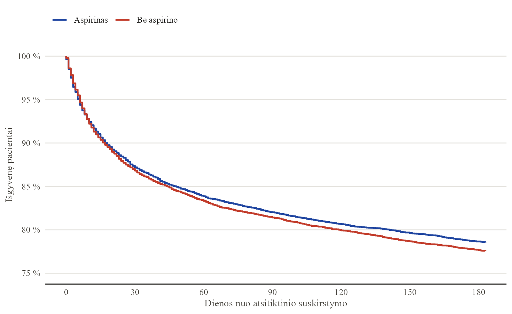
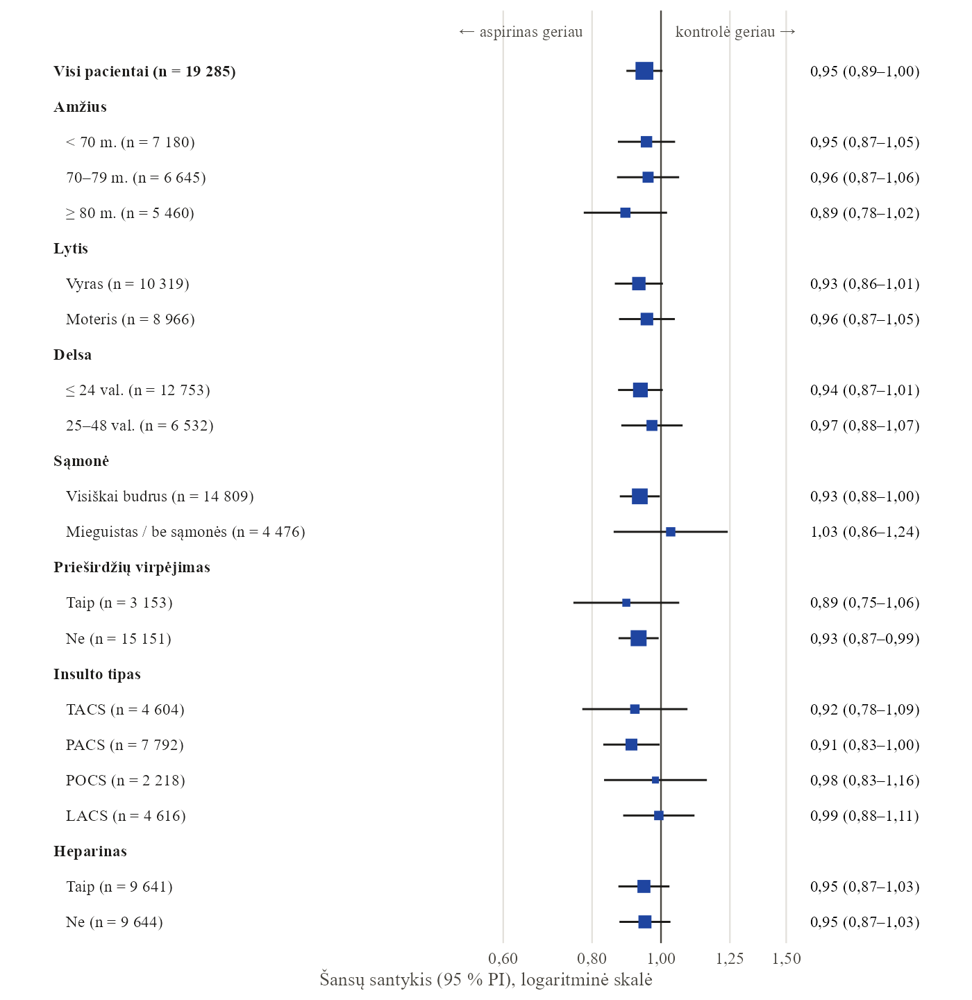

<!-- TODO: kai turėsite 2–3 klientų atvejus (net anonimizuotus), įdėkite "Atvejai" sekciją po paslaugomis – tai stipriausias pasitikėjimo signalas. -->

```{=html}
<section class="s-hero">
  <div class="wrap hero-copy">
    <h1>Statistikas jūsų komandai&nbsp;— <em>tada, kai jo reikia.</em></h1>
    <p class="lede">Padedu įmonėms ir tyrėjams priimti sprendimus, kuriais galima pasitikėti: nuo vienos konsultacijos iki reguliarių ataskaitų ir duomenų sistemų.</p>
    <div class="hero-actions">
      <a href="kontaktai.html" class="btn-blue">Aptarkime jūsų projektą →</a>
      <p class="hero-note">Pirmas 30 min. pokalbis nemokamas</p>
    </div>
    <!-- Atsiradus nuotraukai: įdėkite  į .hero-by prieš <span> -->
    <p class="hero-by"><span><a href="about.html">Paulius Alaburda</a>, statistikas nuo 2015 m. Daugiau nei 200 projektų verslui ir tyrėjams, keturios recenzuotos publikacijos, šiandien vadovauju 18 žmonių duomenų komandai.</span></p>
  </div>
  <div class="mondrian hero-figure" aria-hidden="true">
    <figure class="m-hist h-normal"><figcaption>Normalusis <span class="fx">N(μ, σ²)</span></figcaption><svg viewBox="0 0 100 100" preserveAspectRatio="none" aria-hidden="true"><g class="bars"><rect x="0.0" y="99.2" width="3.704" height="0.8" style="--i:0"/><rect x="3.704" y="99.0" width="3.704" height="1.0" style="--i:1"/><rect x="7.407" y="97.9" width="3.704" height="2.1" style="--i:2"/><rect x="11.111" y="96.1" width="3.704" height="3.9" style="--i:3"/><rect x="14.815" y="92.6" width="3.704" height="7.4" style="--i:4"/><rect x="18.519" y="87.4" width="3.704" height="12.6" style="--i:5"/><rect x="22.222" y="80.4" width="3.704" height="19.6" style="--i:6"/><rect x="25.926" y="69.1" width="3.704" height="30.9" style="--i:7"/><rect x="29.63" y="58.2" width="3.704" height="41.8" style="--i:8"/><rect x="33.333" y="42.1" width="3.704" height="57.9" style="--i:9"/><rect x="37.037" y="30.3" width="3.704" height="69.7" style="--i:10"/><rect x="40.741" y="18.2" width="3.704" height="81.8" style="--i:11"/><rect x="44.444" y="6.9" width="3.704" height="93.1" style="--i:12"/><rect x="48.148" y="0.0" width="3.704" height="100.0" style="--i:13"/><rect x="51.852" y="9.7" width="3.704" height="90.3" style="--i:14"/><rect x="55.556" y="17.1" width="3.704" height="82.9" style="--i:15"/><rect x="59.259" y="26.3" width="3.704" height="73.7" style="--i:16"/><rect x="62.963" y="39.1" width="3.704" height="60.9" style="--i:17"/><rect x="66.667" y="55.8" width="3.704" height="44.2" style="--i:18"/><rect x="70.37" y="69.4" width="3.704" height="30.6" style="--i:19"/><rect x="74.074" y="78.6" width="3.704" height="21.4" style="--i:20"/><rect x="77.778" y="87.9" width="3.704" height="12.1" style="--i:21"/><rect x="81.481" y="92.3" width="3.704" height="7.7" style="--i:22"/><rect x="85.185" y="96.0" width="3.704" height="4.0" style="--i:23"/><rect x="88.889" y="98.0" width="3.704" height="2.0" style="--i:24"/><rect x="92.593" y="99.0" width="3.704" height="1.0" style="--i:25"/><rect x="96.296" y="99.2" width="3.704" height="0.8" style="--i:26"/></g><path class="seps" d="M3.704 0V100M7.407 0V100M11.111 0V100M14.815 0V100M18.519 0V100M22.222 0V100M25.926 0V100M29.63 0V100M33.333 0V100M37.037 0V100M40.741 0V100M44.444 0V100M48.148 0V100M51.852 0V100M55.556 0V100M59.259 0V100M62.963 0V100M66.667 0V100M70.37 0V100M74.074 0V100M77.778 0V100M81.481 0V100M85.185 0V100M88.889 0V100M92.593 0V100M96.296 0V100"/></svg></figure>
    <figure class="m-hist h-expo"><figcaption>Eksponentinis <span class="fx">Exp(λ)</span></figcaption><svg viewBox="0 0 100 100" preserveAspectRatio="none" aria-hidden="true"><g class="bars"><rect x="0.0" y="0.0" width="7.143" height="100.0" style="--i:0"/><rect x="7.143" y="26.0" width="7.143" height="74.0" style="--i:1"/><rect x="14.286" y="43.9" width="7.143" height="56.1" style="--i:2"/><rect x="21.429" y="55.6" width="7.143" height="44.4" style="--i:3"/><rect x="28.571" y="68.2" width="7.143" height="31.8" style="--i:4"/><rect x="35.714" y="76.9" width="7.143" height="23.1" style="--i:5"/><rect x="42.857" y="82.2" width="7.143" height="17.8" style="--i:6"/><rect x="50.0" y="87.0" width="7.143" height="13.0" style="--i:7"/><rect x="57.143" y="90.6" width="7.143" height="9.4" style="--i:8"/><rect x="64.286" y="92.5" width="7.143" height="7.5" style="--i:9"/><rect x="71.429" y="94.5" width="7.143" height="5.5" style="--i:10"/><rect x="78.571" y="96.2" width="7.143" height="3.8" style="--i:11"/><rect x="85.714" y="97.1" width="7.143" height="2.9" style="--i:12"/><rect x="92.857" y="97.8" width="7.143" height="2.2" style="--i:13"/></g><path class="seps" d="M7.143 0V100M14.286 0V100M21.429 0V100M28.571 0V100M35.714 0V100M42.857 0V100M50.0 0V100M57.143 0V100M64.286 0V100M71.429 0V100M78.571 0V100M85.714 0V100M92.857 0V100"/></svg></figure>
    <figure class="m-hist h-uniform"><figcaption>Tolygusis</figcaption><svg viewBox="0 0 100 100" preserveAspectRatio="none" aria-hidden="true"><g class="bars"><rect x="0.0" y="11.6" width="16.667" height="88.4" style="--i:0"/><rect x="16.667" y="20.5" width="16.667" height="79.5" style="--i:1"/><rect x="33.333" y="14.9" width="16.667" height="85.1" style="--i:2"/><rect x="50.0" y="14.1" width="16.667" height="85.9" style="--i:3"/><rect x="66.667" y="17.8" width="16.667" height="82.2" style="--i:4"/><rect x="83.333" y="15.3" width="16.667" height="84.7" style="--i:5"/></g><path class="seps" d="M16.667 0V100M33.333 0V100M50.0 0V100M66.667 0V100M83.333 0V100"/></svg></figure>
    <figure class="m-hist h-bimodal"><figcaption>Bimodalinis</figcaption><svg viewBox="0 0 100 100" preserveAspectRatio="none" aria-hidden="true"><g class="bars"><rect x="0.0" y="98.2" width="7.143" height="1.8" style="--i:0"/><rect x="7.143" y="85.1" width="7.143" height="14.9" style="--i:1"/><rect x="14.286" y="46.2" width="7.143" height="53.8" style="--i:2"/><rect x="21.429" y="0.0" width="7.143" height="100.0" style="--i:3"/><rect x="28.571" y="26.8" width="7.143" height="73.2" style="--i:4"/><rect x="35.714" y="70.3" width="7.143" height="29.7" style="--i:5"/><rect x="42.857" y="83.9" width="7.143" height="16.1" style="--i:6"/><rect x="50.0" y="67.8" width="7.143" height="32.2" style="--i:7"/><rect x="57.143" y="39.4" width="7.143" height="60.6" style="--i:8"/><rect x="64.286" y="34.3" width="7.143" height="65.7" style="--i:9"/><rect x="71.429" y="50.8" width="7.143" height="49.2" style="--i:10"/><rect x="78.571" y="78.5" width="7.143" height="21.5" style="--i:11"/><rect x="85.714" y="94.3" width="7.143" height="5.7" style="--i:12"/><rect x="92.857" y="99.0" width="7.143" height="1.0" style="--i:13"/></g><path class="seps" d="M7.143 0V100M14.286 0V100M21.429 0V100M28.571 0V100M35.714 0V100M42.857 0V100M50.0 0V100M57.143 0V100M64.286 0V100M71.429 0V100M78.571 0V100M85.714 0V100M92.857 0V100"/></svg></figure>
    <figure class="m-yours"><figcaption><span>Kokie jūsų duomenys?</span><span class="fx">n = ?</span></figcaption><div class="yours-bars"><i style="--h:22;--i:0"></i><i style="--h:48;--i:1"></i><i style="--h:81;--i:2"></i><i style="--h:64;--i:3"></i><i style="--h:37;--i:4"></i><i style="--h:52;--i:5"></i><i style="--h:90;--i:6"></i><i style="--h:70;--i:7"></i><i style="--h:41;--i:8"></i><i style="--h:26;--i:9"></i><i style="--h:15;--i:10"></i><i style="--h:8;--i:11"></i></div></figure>
  </div>
</section>

<section id="paslaugos" class="band">
  <div class="wrap">
    <header class="sec-head">
      <h2>Trys būdai dirbti kartu</h2>
      <p>Pradėkite nuo mažo žingsnio. Dažnas ilgalaikis bendradarbiavimas prasideda nuo vienos konsultacijos.</p>
    </header>

    <div class="tiers">
      <article class="tier tier-yellow">
        <h3>Konsultacija</h3>
        <p class="tier-when">Žinote, ką norite daryti, bet reikia antros nuomonės.</p>
        <ul class="dash-list">
          <li>Ar mano imties užteks ir kaip tai pagrįsti</li>
          <li>Kurį testą rinktis ir kaip aprašyti rezultatus</li>
          <li>R ar Python kodo peržiūra prieš pateikiant darbą</li>
          <li>Mokymai komandai su jūsų pačių duomenimis</li>
        </ul>
        <div class="tier-price"><span>nuo <strong>50 € / val.</strong></span><a href="paslaugos.html#konsultacija">Plačiau →</a></div>
      </article>

      <article class="tier tier-red">
        <h3>Projektas</h3>
        <p class="tier-when">Reikia konkretaus rezultato per sutartą laiką ir už sutartą kainą.</p>
        <ul class="dash-list">
          <li>Imties dydžio pagrindimas protokolui ar bioetikos komitetui</li>
          <li>Analizė ir ataskaita publikacijai ar vadovybei</li>
          <li>Ar A/B testo skirtumas tikras, ar tai tik sezonas</li>
          <li>Skaičiuoklė ar interaktyvi aplikacija jūsų komandai</li>
        </ul>
        <div class="tier-price"><span>fiksuota kaina, nuo <strong>50 €</strong></span><a href="paslaugos.html#projektas">Plačiau →</a></div>
      </article>

      <article class="tier tier-blue">
        <h3>Partnerystė</h3>
        <p class="tier-when">Duomenys turi dirbti kiekvieną mėnesį, ne tik vieną kartą.</p>
        <ul class="dash-list">
          <li>Mėnesio ataskaita vadovybei, kuri atsinaujina pati</li>
          <li>Rodikliai, kuriuos visi skaičiuoja vienodai</li>
          <li>Pardavimų, klientų ir veiklos duomenys vienoje vietoje</li>
          <li>Statistikas, kuriam galima parašyti, kai kyla klausimas</li>
        </ul>
        <div class="tier-price"><span><strong>mėnesinis</strong> mokestis</span><a href="paslaugos.html#partneryste">Plačiau →</a></div>
      </article>
    </div>
    <p class="tiers-foot">Tikslią kainą ir terminą sutariame prieš pradedant darbą.</p>
  </div>
</section>

<section class="band band-alt">
  <div class="wrap">
    <header class="sec-head">
      <h2>Pažiūrėkite, ką gausite</h2>
      <p>Klientų darbai konfidencialūs, todėl pavyzdžiui paėmiau viešus Tarptautinio insulto tyrimo duomenis: 19 435 pacientai ir aštuonių puslapių ataskaita nuo neapdorotų duomenų iki išvadų.</p>
    </header>

    <div class="home-sample">
      <figure>
        <a href="pavyzdziai/ist-1/"></a>
        <figcaption>1 pav. Išgyvenamumas per 6 mėnesius pagal gydymą aspirinu</figcaption>
      </figure>
      <figure>
        <a href="pavyzdziai/ist-1/"></a>
        <figcaption>2 pav. Aspirino poveikis pogrupiuose</figcaption>
      </figure>
    </div>

    <p class="home-sample-actions">
      <a href="pavyzdziai/ist-1/" class="btn-ink">Atidaryti pavyzdinę ataskaitą →</a>
      <a href="pavyzdziai/ist-1/ist-1-ataskaita.pdf" class="text-link">PDF, 8 psl.</a>
    </p>
  </div>
</section>

<section id="analize" class="band">
  <div class="wrap">
    <header class="sec-head">
      <h2>Nemokami įrankiai</h2>
      <p>Rašote baigiamąjį darbą ar planuojate tyrimą? Abu įrankiai veikia naršyklėje, lietuviškai ir be registracijos.</p>
    </header>

    <figure class="demo-video">
      <video data-inview muted loop playsinline preload="none" poster="analize/demo/analize-poster.jpg"
             aria-label="Vaizdo įrašas: kaip įrankyje atlikti t testą ir atsisiųsti ataskaitą į Word">
        <source src="analize/demo/analize.webm" type="video/webm">
        <source src="analize/demo/analize.mp4" type="video/mp4">
      </video>
      <figcaption><span>Darbo užmokestis pagal lytį: nuo duomenų iki Word ataskaitos</span><span>~40 s, be garso</span></figcaption>
    </figure>

    <div class="tool-pair">
      <div class="tool">
        <h3>Analizė</h3>
        <p>Įkelkite CSV ar Excel failą ir gaukite rezultatus, grafikus ir aprašymą Word formatu: nuo t testo ir ANOVA iki logistinės regresijos. Duomenys lieka jūsų naršyklėje.</p>
        <a href="analize/" class="btn-yellow">Išbandyti analizę →</a>
      </div>
      <div class="tool" id="imtis">
        <h3>Imties dydis</h3>
        <p>Kiek žmonių apklausti, kiek tiriamųjų reikia kiekvienai grupei ar kiek dienų laukti A/B testo. Su tekstu metodikos skyriui ir R kodu.</p>
        <a href="imtis/" class="btn-yellow">Apskaičiuoti imtį →</a>
      </div>
    </div>

    <p class="tool-more">Įrankis atliks skaičiavimus, bet nepasakys, ar metodas tinka jūsų tyrimui ir kaip rezultatus apginti. Tam yra <a href="kontaktai.html?tema=konsultacija&amp;saltinis=pagrindinis-irankiai">konsultacija</a> ir <a href="straipsniai.html">straipsniai</a>.</p>
  </div>
</section>

<section class="band band-alt">
  <div class="wrap">
    <header class="sec-head">
      <h2>Apie statistiką — lietuviškai</h2>
      <p>Praktiniai gidai, kaip pasirinkti metodą, apskaičiuoti imtį ir teisingai interpretuoti rezultatus.</p>
    </header>
```

::: {#blog-listing}
:::

```{=html}
    <div class="listing-more"><a href="straipsniai.html" class="text-link">Visi straipsniai →</a></div>
  </div>
</section>

<section class="cta-band">
  <div class="wrap">
    <h2>Turite duomenų ir klausimą?</h2>
    <p>Parašykite kelis sakinius apie savo situaciją. Atsakysiu, kaip galiu padėti, ir pasiūlysiu pirmą žingsnį.</p>
    <div class="cta-actions">
      <a href="kontaktai.html" class="btn-yellow">Aptarkime projektą →</a>
      <a href="mailto:info@statistikas.lt" class="cta-mail">info@statistikas.lt</a>
    </div>
  </div>
</section>
```
