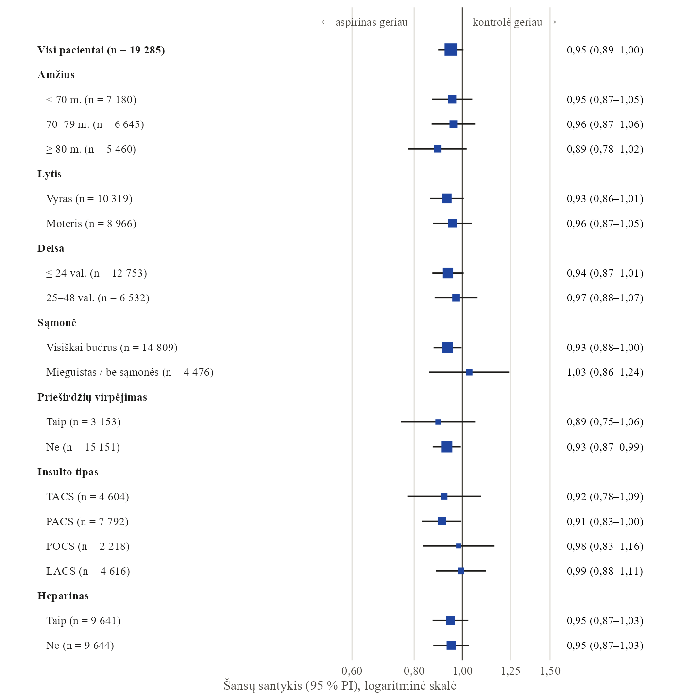
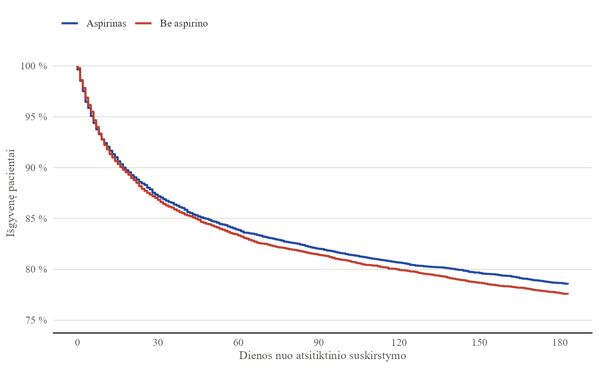

<!-- Ataskaitos šaltinis: _ataskaita/ist-1.qmd. Atnaujinti: cd _ataskaita && Rscript render.R -->

```{=html}
<section class="page-hero sample-hero">
  <div class="wrap sample-hero-grid">
    <div>
      <span class="eyebrow">Pavyzdinė ataskaita</span>
      <h1>Aspirinas po insulto: 19 435 pacientų duomenų analizė.</h1>
      <p class="lede">Klientų darbai konfidencialūs, todėl parodyti, ką gausite, pasirinkau viešus Tarptautinio insulto tyrimo (IST-1) duomenis. Tai ta pati ataskaita, kokią paruoščiau jums: nuo neapdorotų duomenų iki išvadų, lentelių ir grafikų.</p>
      <div class="sample-actions">
        <a href="ist-1-ataskaita.pdf" class="btn-blue btn-big" download>Atsisiųsti PDF ataskaitą ↓</a>
        <a href="ist-1-ataskaita.docx" class="text-link" download>arba Word versiją (.docx)</a>
      </div>
      <p class="sample-meta mono">8 psl. · 4 lentelės · 2 grafikai · PDF, 0,4 MB</p>
    </div>
    <a class="sample-cover" href="ist-1-ataskaita.pdf" aria-label="Atidaryti PDF ataskaitą">
      
      <span class="sample-cover-tag mono">2 pav. iš ataskaitos</span>
    </a>
  </div>
</section>

<section class="band">
  <div class="wrap">
    <div class="section-head">
      <div>
        <span class="eyebrow">Užduotis</span>
        <h2>Klausimas, kaip jį užduotų klientas</h2>
      </div>
      <p>Ar aspirinas ar heparinas, paskirti per 48 valandas nuo insulto, sumažina mirties ir priklausomybės riziką po 6 mėnesių? Ir ar poveikis vienodas visiems pacientams?</p>
    </div>

    <div class="steps">
      <div class="step">
        <span class="chip chip-yellow">01</span>
        <h3>Duomenų paruošimas</h3>
        <p>112 kintamųjų, 19 435 pacientai. Perkodavau kintamuosius, apibrėžiau baigtis ir patikrinau trūkstamus duomenis.</p>
      </div>
      <div class="step">
        <span class="chip chip-red">02</span>
        <h3>Analizė</h3>
        <p>Dažnių palyginimas, logistinė regresija su prognoziniais veiksniais, Kaplan–Meier išgyvenamumas ir pogrupių analizė.</p>
      </div>
      <div class="step">
        <span class="chip chip-blue">03</span>
        <h3>Patikra</h3>
        <p>Pagrindiniai rezultatai sutampa su paskelbtais <em>The Lancet</em> (1997): 9,0 % ir 9,4 % mirčių per 14 dienų, 62,2 % ir 63,5 % mirusių ar priklausomų po 6 mėn.</p>
      </div>
      <div class="step">
        <span class="chip chip-ink">04</span>
        <h3>Ataskaita</h3>
        <p>Santrauka, metodai, APA stiliaus lentelės, grafikai ir išvados su ribotumais. Word ir PDF formatu.</p>
      </div>
    </div>
  </div>
</section>

<section class="band band-alt">
  <div class="wrap">
    <div class="section-head">
      <div>
        <span class="eyebrow">Rezultatas</span>
        <h2>Ką rasite ataskaitoje</h2>
      </div>
      <p>Santrauka pirmame puslapyje: atsakymas į klausimą be statistinio žargono. Toliau – viskas, ko reikia recenzentui ar vadovybei patikrinti.</p>
    </div>

    <figure class="sample-figure">
      
      <figcaption><span>1 pav. Išgyvenamumas per 6 mėnesius pagal gydymą aspirinu</span><span>iš ataskaitos, 5 psl.</span></figcaption>
    </figure>

    <ul class="dash-list sample-list">
      <li><strong>Santrauka:</strong> aspirinas mirties ar priklausomybės riziką sumažino 1,3 procentinio punkto (koreguotas ŠS 0,92); heparino naudą atsvėrė kraujavimai.</li>
      <li><strong>4 lentelės</strong> pagal APA: imties charakteristikos, baigtys su rizikos skirtumais, logistinės regresijos modelis, heparino dozių palyginimas.</li>
      <li><strong>2 grafikai:</strong> Kaplan–Meier išgyvenamumo kreivės ir pogrupių analizės „forest plot“.</li>
      <li><strong>Metodų aprašymas</strong>, kurį galima perkelti į publikaciją, ir <strong>ribotumai</strong>, kuriuos verta žinoti prieš darant išvadas.</li>
      <li><strong>Pakartojamas kodas:</strong> ataskaita sugeneruota iš R ir Quarto, todėl ją galima atnaujinti gavus naujų duomenų.</li>
    </ul>

    <p class="sample-again">
      <a href="ist-1-ataskaita.pdf" class="btn-ink" download>Atsisiųsti PDF ↓</a>
      <a href="ist-1-ataskaita.docx" class="text-link" download>Word versija</a>
    </p>
  </div>
</section>

<section class="band">
  <div class="wrap sample-source">
    <span class="eyebrow">Duomenys</span>
    <p>Sandercock PAG, Niewada M, Członkowska A, International Stroke Trial Collaborative Group. The International Stroke Trial database. <em>Trials</em> 2011;12:101. <a href="https://doi.org/10.1186/1745-6215-12-101">doi:10.1186/1745-6215-12-101</a>. Analizuota pataisyta duomenų versija (<a href="https://datashare.ed.ac.uk/handle/10283/124">Edinburgo universiteto DataShare</a>, licencija ODC-By 1.0). Ataskaita yra metodinis pavyzdys, o ne gydymo rekomendacija.</p>
  </div>
</section>

<section class="cta-band">
  <div class="wrap cta-grid">
    <div>
      <span class="eyebrow">Jūsų duomenys</span>
      <h2>Norite tokios ataskaitos savo tyrimui?</h2>
      <p>Klinikinis tyrimas, apklausa ar verslo duomenys – aprašykite situaciją keliais sakiniais, ir pasiūlysiu, kaip galiu padėti. Pirmas pokalbis nemokamas.</p>
      <div class="cta-actions">
        <a href="../../kontaktai.html?tema=projektas&amp;saltinis=pavyzdys-ist1" class="btn-yellow">Aptarkime jūsų projektą →</a>
        <a href="mailto:info@statistikas.lt" class="cta-mail">info@statistikas.lt</a>
      </div>
    </div>
    <div class="mondrian cta-art" aria-hidden="true">
      <div class="m-blue"></div><div class="m-yellow"></div><div class="m-red"></div>
    </div>
  </div>
</section>
```
